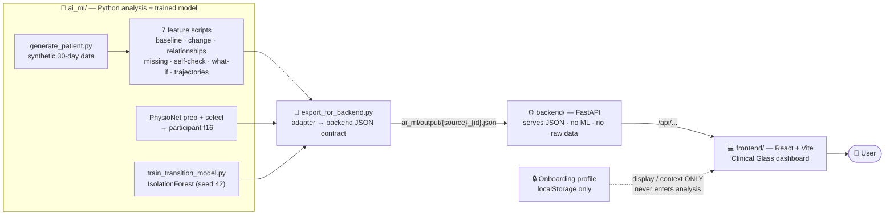

# TRACE — Temporal Reasoning & Analysis for Clinical Exploration

> **Find where the story changed.**

**Hackachusetts track: Healthcare & Biotech**

**🔗 Live demo:** https://pranathivutla30.github.io/Trace/ — the full dashboard
runs in the browser with the real analysis bundled as static data (no backend
needed). Open it, finish the short onboarding, and explore both the Synthetic
Demo and the Real Wearable Data (f16).

TRACE is an exploratory, **non-diagnostic** tool that analyzes longitudinal
physiological data (wearable signals over time) to answer four questions a raw
chart can't: **when** did a person's pattern start changing, **what** signals
changed together, **what information is missing** to explain it, and **how
confident** the interpretation is — plus "what if" and "what could happen next"
scenarios.

It runs on two data sources:

- **Synthetic Patient 001** — a controlled 30-day patient that demonstrates all
  **seven** TRACE reasoning capabilities.
- **Real f16** — a de-identified **PhysioNet** wearable recording used to
  validate the core temporal reasoning, plus a **trained anomaly model**
  evaluated on held-out real data.

> TRACE does **not** diagnose disease, determine stress severity, predict
> clinical outcomes, or provide medical advice. Scores describe *patterns and
> deviations from a personal baseline*, not health risk.

---

## What it does (features)

| # | Feature (codename) | What you see |
|---|---|---|
| 1 | Your Baseline — *BioShadow* | Each signal's usual value vs. latest, and how far from normal |
| 2 | Where It Changed — *BioTimeMachine* | The earliest day the signals began shifting together |
| 3 | What Changed Together — *ReverseHealth* | Which signals moved, and in what order (association, not cause) |
| 4 | What to Learn Next — *BioMissing* | The missing context that would most reduce uncertainty |
| 5 | Can We Trust This — *AI Self-Check* | How sure TRACE is about its own reading (not a health risk) |
| 6 | What If — *Counterfactual* | How much each signal drove the overall change |
| 7 | Where Could the Path Diverge — *HealthFork* | Three example future scenarios (not predictions) |
| + | ML Physiological Anomaly | A trained model scoring how unusual each moment looks vs. a learned normal |

Plus a polished **onboarding + profile** flow (saved locally in the browser)
and a **"Your Context"** card that compares your self-reported habits with the
investigation — clearly labeled as context only, never fed into the analysis.

---

## Architecture

TRACE is a **one-directional pipeline** — data flows left to right, and each
layer has a single job. By the time results reach the UI they are immutable, so
the dashboard can never alter an analysis value.



If Mermaid doesn't render, here's the same flow:

```
  ┌──────────────────────────────────────────────┐
  │  ai_ml/  — Python analysis + trained model     │
  │  generate_patient → 7 feature scripts          │
  │  PhysioNet prep/select (→ f16) · IsolationForest│
  └───────────────────────┬────────────────────────┘
                          │  outputs/*.json
                          ▼
  ┌──────────────────────────────────────────────┐
  │  export_for_backend.py  (adapter)              │
  │  → ai_ml/output/{source}_{id}.json             │
  └───────────────────────┬────────────────────────┘
                          │
                          ▼
  ┌──────────────────────────────────────────────┐
  │  backend/  — FastAPI                            │
  │  serves JSON · runs no ML · reads no raw data   │
  └───────────────────────┬────────────────────────┘
                          │  /api/...
                          ▼
  ┌──────────────────────────────────────────────┐
  │  frontend/  — React + Vite (Clinical Glass)     │
  └──────────────────────────────────────────────┘
          ▲
          ┆  display / context ONLY (never enters analysis)
  ┌───────┴────────────────┐
  │  Onboarding profile      │
  │  (localStorage only)     │
  └──────────────────────────┘
```

| Layer | Responsibility | Does **not** |
|---|---|---|
| `ai_ml/` | Compute all analysis + train the model | — |
| `export_for_backend.py` | Reshape pipeline output into the backend contract | change any value |
| `backend/` (FastAPI) | Serve standardized JSON | run ML or read raw data |
| `frontend/` (React) | Render the dashboard | compute or alter analysis |

> **Privacy firewall:** the onboarding profile lives only in the browser
> (`localStorage`). It personalizes the UI and the "Your Context" card, but is
> **never** sent to the backend or fed into any AI/ML result.

---

## Run it locally

Requirements: Python 3.9+ and Node 18+.

**1. Backend (FastAPI)**
```bash
cd backend
pip install -r requirements.txt
uvicorn main:app --reload        # http://localhost:8000  (docs at /docs)
```

**2. Frontend (React + Vite)**
```bash
cd frontend
npm install
npm run dev                      # http://localhost:5173
```
The dev server proxies `/api` to the backend automatically.

**3. (Optional) regenerate the data the backend serves**
```bash
python ai_ml/export_for_backend.py   # writes ai_ml/output/*.json
```

**Using the app:** open the frontend, complete the short onboarding (saved in
your browser), choose **Synthetic Demo** or **Real Wearable Data (f16)**, and
explore the dashboard. Switch sources any time from the top toggle.

---

## Repository layout

- `ai_ml/` — the seven analysis scripts, PhysioNet preprocessing/selection, and
  the IsolationForest trainer (`train_transition_model.py`, seed 42)
- `models/` — the trained model + metadata
- `outputs/` and `ai_ml/output/` — generated analysis JSON (raw + backend-ready)
- `data/synthetic/` — the synthetic patient CSVs
- `backend/` — FastAPI service
- `frontend/` — React dashboard (Clinical Glass theme)
- `.kiro/` — steering docs and the spec (requirements / design / tasks) used to
  build TRACE with Kiro

---

## Data & attribution

Real wearable data contains information from the *Wearable Device Dataset from
Induced Stress and Structured Exercise Sessions (v1.0.1), PhysioNet* — Hongn, A.,
Bosch, F., Prado, L., & Bonomini, P. (2025). https://doi.org/10.13026/he0v-tf17 .
The dataset is made available under the **Open Data Commons Attribution License
(ODC-By) v1.0** (https://opendatacommons.org/licenses/by/1-0/), which permits
derivative works with attribution. Raw dataset files are **not** redistributed
here; only processed window features (a derivative database) and derived analysis
JSON are included, with attribution in `data/processed/physionet/README.md`.

## Disclaimer

TRACE is a hackathon prototype for exploratory temporal analysis. It is not a
medical device and does not provide diagnosis, risk scoring, or treatment advice.
The locally-stored profile is a prototype convenience, not secure or
HIPAA-compliant storage.
